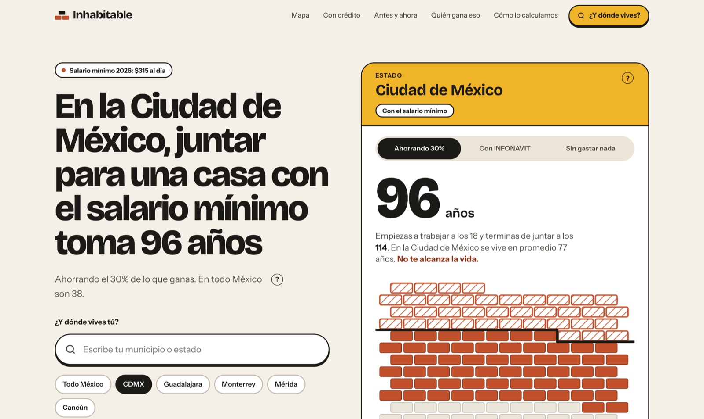
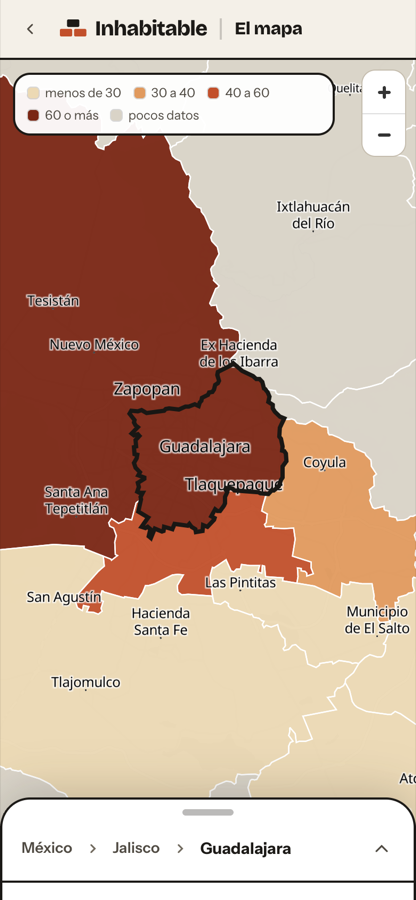

<div align="center">

# 🧱 Inhabitable

### ¿Cuántos años de tu vida cuesta una casa en México?

**Con el salario mínimo, una casa en la Ciudad de México cuesta 96 años de ahorro. En todo el país, 38.**<br>
Si empiezas a trabajar a los 18, terminas de juntar a los 56… y en México se vive en promedio 76.

[**inhabitable.vercel.app**](https://inhabitable.vercel.app) · [El mapa](https://inhabitable.vercel.app/mapa)




</div>

---

## De qué va

Inhabitable es un sitio ciudadano de **periodismo de datos**: no asesora, no vende créditos, no te ayuda a comprar.
Expone una injusticia: **los precios de la vivienda en México no se pueden pagar con lo que gana casi la mitad de quienes trabajan.**

Buscas tu estado o municipio y te dice, en tu vida, lo que cuesta una casa:

| | |
|---|---|
| 🧱 **Años de ahorro** | Cuántos años juntando el 30 % del salario mínimo. Cada año es un tabique. |
| ⏳ **Tu vida** | Empiezas a los 18: a qué edad terminas y cuántos años te quedan (o si no te alcanza la vida). |
| 🏦 **Con INFONAVIT** | Si ni con el crédito más alto para quien gana el mínimo alcanza. |
| 📈 **Antes y ahora** | Cuántos años costaba cada año desde 2005, con el precio y el salario de ese año. |
| 🗺️ **El mapa** | Los 32 estados y sus municipios, del más caro al más barato. |

<table>
<tr>
<td width="62%">

### 🗺️ El mapa

[`/mapa`](https://inhabitable.vercel.app/mapa) a pantalla completa, en tres niveles:

1. **México:** toca tu estado.
2. **Estado:** el mapa se acerca y se colorean sus municipios.
3. **Municipio:** su ficha, con un botón a "tu vida completa".

Tocar fuera del estado regresa a todo México; tocar el mismo municipio regresa al estado; <kbd>Esc</kbd> sube un nivel.
En celular, el panel es una hoja inferior que se arrastra (abajo, a la mitad, arriba).
La selección vive en la dirección (`/mapa?e=jalisco&m=guadalajara`), así que se puede compartir.

</td>
<td width="38%"></td>
</tr>
</table>

## 📊 Datos

Todo sale de fuentes públicas oficiales, con fecha a la vista en el sitio.

| Dato | Fuente | Frecuencia |
|---|---|---|
| Precio de la vivienda por estado (mediana, cuartiles) | **SHF**, Índice SHF de Precios de la Vivienda | semestral |
| Precio estimado por municipio | **SNIIV (SEDATU)**, créditos para comprar vivienda por rango de precio | mensual |
| Salario mínimo (general y frontera norte) | **CONASAMI**, vía SIE de Banxico | anual |
| Inflación | **INEGI**, INPC, vía SIE de Banxico | mensual |
| Quién gana el mínimo o menos | **INEGI**, ENOE | trimestral |
| Esperanza de vida por estado | **CONAPO**, proyecciones 2020–2070 | anual |
| Tasa hipotecaria | **Banxico**, citada por la SHF | trimestral |

**Cómo se calcula:** precio típico (mediana) ÷ lo que se junta en un año ahorrando el 30 % del salario mínimo, sin intereses ni aumentos.

**Municipios:** el SNIIV no da precios, sino cuántos créditos hubo en cada rango de precio. Con esa distribución se estima la
mediana (mediana agrupada). Comparado con la cifra oficial de la SHF en cada estado, el cálculo casi siempre **se queda corto**:
los años reales pueden ser más. Solo se publican municipios con 50 créditos o más en 12 meses; arriba del rango más caro se dice "150+ años".

**Lo que no dice:** solo cuenta casas compradas con crédito; no incluye la vivienda que la gente construye por su cuenta.

## 🛠️ Desarrollo

```bash
npm install
npm run dev -- --port 3200
```

| Comando | Qué hace |
|---|---|
| `npm run data:bajar` | Baja de Banxico el salario mínimo y el INPC (abre Chrome: el sitio no acepta scripts sueltos) |
| `npm run data` | Rehace `src/data/*.json` y `public/data/municipios.json` desde `data/fuentes/` y `data/raw/` |
| `python3 -I scripts/fetch_sniiv.py` | Baja del SNIIV los créditos por municipio, mes y rango de precio |
| `node scripts/fetch_shf.mjs <url>` | Abre el boletín de la SHF y baja sus archivos (gob.mx bloquea `curl`) |

Los scripts de datos usan solo la biblioteca estándar de Python. Las fuentes crudas van en `data/raw/` (fuera de git).
El paso a paso de cada actualización (enero: salario nuevo; agosto: índice SHF nuevo) está en [`data/COMO-ACTUALIZAR.md`](data/COMO-ACTUALIZAR.md).

## 🎨 Diseño

- **Metáfora:** cada año de ahorro es un tabique; la barda de tu resultado se levanta de abajo hacia arriba.
- **Materiales de obra:** cal `#f4f0e8`, cemento `#ebe5d9`, tabique `#c2502b`, carbón `#1c1a17` y amarillo de obra `#f0b429`.
- **Tipografía:** Bricolage Grotesque (titulares y cifras) e Instrument Sans (texto).
- **Escala del mapa** (años ahorrando el 30 %), validada para daltonismo: `#ecd9b4` → `#e19a5e` → `#c2502b` → `#7a2614`.
- Mapa con MapLibre GL y la base positron de OpenFreeMap (gratis, sin token). Límites municipales: INEGI.

---

<div align="center">

Proyecto ciudadano independiente, sin fines de lucro. **No está afiliado al INFONAVIT** ni a ninguna dependencia de gobierno;
el nombre es un juego de palabras.

Proyecto hermano de [**Sinagua**](https://www.sinagua.org), sobre la falta de agua en México.

¿Tienes datos, sabes del tema o quieres ayudar? [Escríbeme en LinkedIn](https://www.linkedin.com/in/eduardo-chacon-171367275/)

</div>
